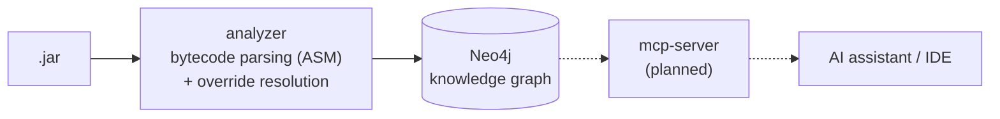

# jar-graph-mcp

Turn compiled Java code into a queryable knowledge graph, so AI assistants can **look up** the structure of a codebase
instead of guessing it.

## Why

LLMs lack a complete picture of the dependencies between classes, methods and interfaces, and it is often hard to give
them enough context to understand the code. Enterprise monoliths are typically built on a deep hierarchy of such
dependencies, which forces you to keep in the workspace even projects you have no need to change, just so the assistant
can see them.

The approach I adopted is the opposite: keep in the workspace only the projects you are actually changing, and give
the model an MCP server able to explore the whole codebase. Dependencies don't need to be checked out: their compiled
JARs are enough.

The MCP server can also work alongside the GitHub MCP server: the graph pinpoints the relevant classes, and GitHub
provides their source code.

## How it works

The graph is built in CI from the artifact the build already produces (e.g. a Spring Boot fat jar), so it always
reflects the latest build of the application, internal dependencies included.



1. **Analyzer**: reads the `.class` files of a JAR with [ASM](https://asm.ow2.io/) and extracts classes, interfaces,
   inheritance, methods, method calls and `@Transactional` markers, straight from bytecode (no source code needed).
   It then works out which methods override which, so that a call to an interface can be followed to the code that
   actually runs.
2. **Knowledge graph**: the model is persisted to Neo4j as nodes and relationships, queryable with Cypher.
3. **MCP server** _(planned)_: exposes graph traversals to AI assistants through the
   [Model Context Protocol](https://modelcontextprotocol.io/), so the IDE can fetch the exact context of the code
   being changed.

## Status

| Component | Status |
|-----------|--------|
| Bytecode parser (classes, interfaces, methods, calls, `@Transactional`) | ✅ Done |
| Neo4j persistence (chunked writes, integration-tested with Testcontainers) | ✅ Done |
| Inheritance and override resolution (abstract classes, interface hierarchies) | ✅ Done |
| Bridge methods (generics, covariant return types) | ✅ Done |
| Calls to inherited methods through a subclass reference | 🚧 Next |
| Nested archives (Spring Boot fat jar, WAR, EAR) | 📋 Planned |
| Parser fidelity (lambdas / method references) | 📋 Planned |
| MCP server | 📋 Planned |
| AWS deployment | 📋 Planned |

## Quick start

Prerequisites: JDK 21, Maven 3.9+, Docker.

```bash
# 1. Start Neo4j (browser on http://localhost:7474, user neo4j / password123)
docker compose up -d

# 2. Build the analyzer (runs unit tests)
mvn -pl analyzer -am package

# 3. Analyze a JAR (here: the analyzer itself)
mvn -q -pl analyzer exec:java \
    -Dexec.mainClass=com.jgraph.analyzer.AppAnalyzer \
    -Dexec.args=analyzer/target/analyzer-1.0.0-SNAPSHOT.jar
```

> ⚠️ Each run **replaces** the whole graph: one artifact per analysis.

Connection settings come from `analyzer/src/main/resources/application.properties` and can be overridden with the
`NEO4J_URI`, `NEO4J_USERNAME` and `NEO4J_PASSWORD` environment variables.

### Example queries

Run them in the Neo4j Browser after analyzing the analyzer's own JAR.

Which classes implement an interface?

```cypher
MATCH (c:Class)-[:IMPLEMENTS]->(:Class {fqcn: 'com/jgraph/analyzer/repository/GraphRepository'})
RETURN c.fqcn AS implementation
```

What does `main` reach within two calls?

```cypher
MATCH (:Method {name: 'main'})-[:CALLS*1..2]->(m:Method)<-[:DECLARES]-(:Class)
RETURN DISTINCT m.signature AS reachable
```

Bytecode records calls against the declared type (often an interface). Follow `OVERRIDES` to the code that actually
runs, including methods inherited from abstract base classes:

```cypher
MATCH (caller:Method)-[:CALLS]->(declared:Method {name: 'save'})<-[:OVERRIDES*0..]-(impl:Method)
WHERE NOT impl.isAbstract
RETURN caller.signature AS caller, impl.signature AS resolvedTarget
```

Which classes extend a library type?

```cypher
MATCH (c:Class)-[:EXTENDS]->(s:Class)
WHERE s.fqcn STARTS WITH 'org/objectweb/asm/'
RETURN c.fqcn AS class, s.fqcn AS superclass
```

Which library or JDK methods does a class depend on?

```cypher
MATCH (:Class {fqcn: 'com/jgraph/analyzer/parser/ModelBuildingClassVisitor'})-[:DECLARES]->(m)-[:CALLS]->(ext:Method)
WHERE NOT ()-[:DECLARES]->(ext)
RETURN m.name AS method, collect(DISTINCT ext.signature) AS externalCalls
```

## Graph model

```
(:Class {fqcn, simpleName, kind, isAbstract})-[:EXTENDS]->(:Class)             class -> superclass, interface -> superinterface
(:Class)-[:IMPLEMENTS]->(:Class)                                               class -> interface
(:Class)-[:DECLARES]->(:Method {signature, name, descriptor, returnType, parameterTypes,
                                visibility, isStatic, isAbstract, isBridge, isTransactional})
(:Method)-[:CALLS]->(:Method)
(:Method)-[:OVERRIDES]->(:Method)                                              nearest overridden declaration
```

- `fqcn` is the JVM internal name (`com/acme/OrderService`); `signature` is `owner#name + descriptor`, unique even
  across overloads.
- Classes and methods referenced but not included in the analysis (JDK, libraries) appear as nodes without a
  `DECLARES` relationship.
- `kind` is one of `CLASS`, `INTERFACE`, `ENUM`, `RECORD`, `ANNOTATION`. Supertypes added implicitly by the compiler
  (`java/lang/Object`, `Record`, `Enum`, `annotation/Annotation`) are not linked: they would only add supernodes.
- `OVERRIDES` follows the Java rules (no static, private or constructor overrides; package-private only within the same
  package) and is computed at ingestion time ([ADR-0006](docs/adr/0006-resolve-overrides-at-ingestion.md)).
- Bridge methods generated by javac (generics, covariant return types) stay in the graph with `isBridge = true`, but
  never own an `OVERRIDES`: it starts from the method the developer wrote
  ([ADR-0007](docs/adr/0007-keep-bridge-methods-and-attribute-overrides.md)). Queries that list methods should add
  `WHERE NOT m.isBridge`.

### Known limitations

- `CALLS` points to the type declared at the call site; resolving the runtime implementation needs `OVERRIDES`
  (see the query above).
- A call to an inherited method through a subclass reference (`sub.inherited()`) points to a method the subclass does
  not declare, not yet linked to the superclass declaration.
- Calls that target a visibility bridge directly (a public class inheriting from a package-private one) resolve to the
  bridge, one `CALLS` away from the real method.
- Methods of JDK or library supertypes are unknown, so implementing them (e.g. `Comparable#compareTo`) creates no
  `OVERRIDES` relationship.
- Calls through lambdas and method references (`invokedynamic`) are not captured yet.
- Only top-level `.class` entries are read: classes inside nested JARs are not analyzed yet.

## Architecture decisions

Significant design decisions, with their context and trade-offs, are recorded as
[Architecture Decision Records](docs/adr/README.md).

## Tests

```bash
mvn -pl analyzer -am test     # unit tests
mvn -pl analyzer -am verify   # + integration tests against a real Neo4j (Testcontainers, requires Docker)
```

## Roadmap & cloud vision

Once the local MCP server is proven to work end to end, the next step is scaling to the cloud with an event-driven
architecture on AWS:

1. **Ingestion**: uploading a JAR to Amazon S3 emits an event that, through Amazon EventBridge, starts an analysis task
   on Amazon ECS (Fargate).
2. **Analysis**: the task parses the JAR and populates the graph database, either Neo4j (Aura or self-managed on AWS)
   or Amazon Neptune.
3. **MCP server**: runs as an ECS service and exposes a set of tools the LLM can call.
4. **Security**: MCP clients authenticate with OAuth 2.1, as required by the MCP authorization specification (e.g. with
   Amazon Cognito as the authorization server), while IAM roles govern access between AWS services.
5. **Infrastructure as code**: the whole AWS infrastructure is provisioned with Terraform.

## License

[Apache License 2.0](LICENSE)
